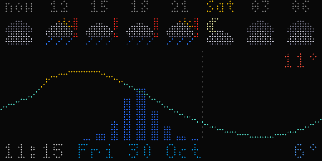
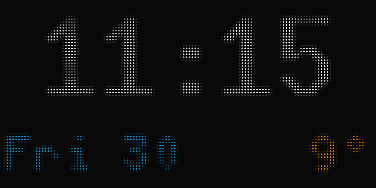
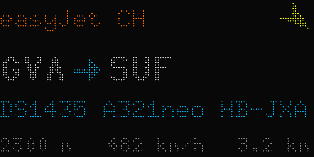
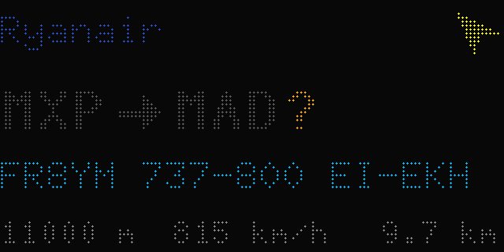
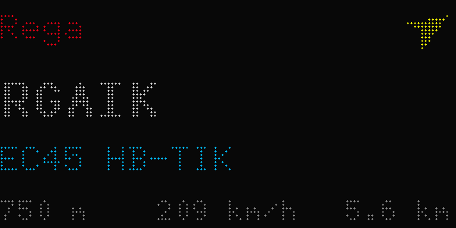
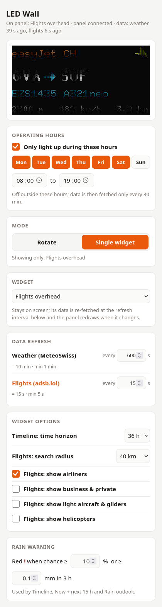

# LED-Wall

A 128×64 RGB LED matrix on the wall, showing a clock, the MeteoSwiss forecast for Ecublens and a FlightWall-style display of the plane overhead.

A small Python server renders every frame and streams it over TCP to an ESP32. The ESP32 only puts pixels on the panel, so adding or changing screens never needs a reflash.

```
MeteoSwiss / adsb.lol ──HTTPS──> server (Python + Pillow, renders the frames)
                                    │ TCP :7777, RGB565 frames
                                    ▼
                         ESP32 (WiFi) ──HUB75──> 128×64 panel (FM6353)
```

## Screens

| Screen | Shows | Source |
|---|---|---|
| `clock` | HH:MM with a blinking colon, date, current temperature | local time, MeteoSwiss |
| `weather` | Icon, current temperature, today's min/max. Next 40 h as a temperature line with rain bars, night shading and midnight markers | MeteoSwiss app API (`plzDetail`) |
| `forecast` | Three days: weekday, icon, min/max, rain | MeteoSwiss |
| `flights` | Native 128×64. Nearest airborne aircraft: 16×16 airline logo, airline or operator (in its colour; for business jets, helicopters and light aircraft the type in words, e.g. "Airbus H145", or the category), route `GVA→SUF` (a stored route that contradicts the aircraft's position or heading is shown dimmed with an orange "?"; with no stored route, the callsign, type and registration). Callsigns are shown short, with the airline's IATA code (KLM591 → KL591); under a route the line reads callsign, type and registration, altitude in metres, ground speed, distance, track arrow. With an empty sky it shows "No aircraft" and the last plane seen | [adsb.lol](https://adsb.lol) + VRS route data |
| `timeline` | MeteoSwiss-style strip from the current 3-hour slot, 24 h by default and settable from 9 to 48 h (beyond about 30 h one icon covers a group of slots, flagged if any is wet): eight full-width slots (hour, icon, red **!** when rain is likely; the first labelled "now") above a temperature curve with hourly rain bars. Status line at the bottom with clock, date and the minimum temperature | MeteoSwiss (3 h icons, rain probability, hourly rain) |
| `nownext` | Big current icon and temperature, today's min/max; next five 3-hour slots with icon, temperature, rain-probability bar and % (red with **!** when likely) | MeteoSwiss |
| `tracker` | Follows one chosen aircraft anywhere: logo, airline and flight, route (same plausibility check as `flights`), progress bar from origin to destination with km left and ETA, altitude, speed, distance from home. Enter a flight number (KL591), callsign (KLM591), registration (PH-EXA) or ICAO hex on the control page; a flight number is mapped to the airline's callsign via the airline list. Shows "not in the air" when it isn't flying | adsb.lol (`/v2/callsign`, `/v2/reg`, `/v2/hex`) |
| `radar` | MeteoSwiss rain radar: the latest 5-minute rain-rate image over dim lake shores and borders, with home marked and the image time top left. Area: Lake Geneva (1 km per LED), Romandie (2 km) or Switzerland (3.5 km) | MeteoSwiss open data, RZC radar composite |
| `rain` | Rain first: "Rain 18:00 · 4.2 mm" headline (or "Dry next 48 h"), 24 hourly rain bars with probability behind them, 3-hour icon strip | MeteoSwiss |

`timeline`, `nownext` and `rain` draw at the native 128×64. The red **!** threshold (probability % and mm per 3 h) is set on the control page.

A screen without data is skipped. A new aircraft that comes close and low can interrupt the rotation.

## Screenshots

Rendered with the LED look by `server/screenshots.py`. The timeline uses live MeteoSwiss data with a simulated shower, so the rain warnings appear. The flights examples omit airline logos, which the panel shows to the left of the airline name.

| | |
|---|---|
| <br>`timeline`: 24 h strip, red **!** where rain is likely | <br>`clock` |
| <br>`flights`: route checked against the aircraft | <br>`flights`: stored route contradicts the aircraft, shown dimmed with "?" |
| <br>`flights`: helicopter, operator by callsign | |

## Control page

The server serves a control page on port 8080, e.g. `http://pigate.local:8080`. It has no login, so keep it on the LAN or a tailnet. On the page you can:
- switch between **Rotate** (cycle through the ticked widgets in order, each for its own number of seconds) and **Single widget** (one widget stays up);
- reorder the widgets, use **Show now**, and watch a live preview of the panel;
- set how often each data source is re-fetched (weather at least every 60 s, flights at least every 5 s). A source no visible widget uses drops to polling every 5 min;
- set widget options: the flight to track, the radar map area, the Timeline's time horizon (9–48 h), the flight search radius (10–150 km, default 40 km), and which aircraft groups the flights widget shows (airliners, business & private, light aircraft & gliders, helicopters). Unticked groups are ignored entirely, including for alerts;
- turn flight alerts on or off;
- set **operating hours**: the days and the window during which the panel lights up (default Mon–Sat 08:00–19:00). Outside them the panel is dark and data is fetched only every 30 min. A window may run past midnight.



Changes apply immediately and auto-save to `~/.local/state/ledwall/settings.json`. That file is outside the code tree, so deploys don't touch it.

In single mode the widget's data is re-fetched at its refresh interval, and the panel redraws when the data changes. If the chosen widget has no data yet (for example, no aircraft overhead), the clock is shown instead.

The page is backed by a small JSON API:

| Method | Path | Purpose |
|---|---|---|
| `GET` | `/api/settings` | Settings and widget/source metadata |
| `PUT` | `/api/settings` | Update settings (partial updates allowed); returns 400 with an error message if invalid |
| `POST` | `/api/show` | `{"name": "weather"}`: jump to that widget now |
| `GET` | `/api/status` | On/off (operating hours), widget on the panel, connected panels, data age |
| `GET` | `/api/frame.png` | The current frame, rendered with an LED look |

## Hardware

- **ESP32**: a generic ESP32-WROOM devkit (ESP32-D0WD-V3, 4 MB flash, CH340 USB-serial).
- **Panel**: sold as Waveshare *RGB-Matrix-P2.5-64x32*, but the unit is **128×64 with 1/32 scan**, and its driver chips are **FM6353** (S-PWM, with their own frame memory). Standard HUB75 libraries leave this panel dark. See [Panel quirks](#panel-quirks).
- **Power**: the panel needs its own 5 V supply, at least 4 A, ideally 6–8 A. The ESP32 can run from any USB charger, or from the same 5 V supply through its 5V/VIN pin. Panel GND and ESP32 GND must be connected.

### Wiring

This follows the ESP32 diagram on Waveshare's wiki (the 64×64 one, which includes E). B is GPIO22, not the library default of 19.

| HUB75 | R1 | G1 | B1 | R2 | G2 | B2 | A | B | C | D | E | LAT | OE | CLK | GND |
|---|---|---|---|---|---|---|---|---|---|---|---|---|---|---|---|
| GPIO | 25 | 26 | 27 | 14 | 12 | 13 | 23 | 22 | 5 | 17 | 32 | 4 | 15 | 16 | GND |

The ribbon goes into the panel's **input** connector (JIN; the arrows on the PCB point away from it).

## Firmware (`firmware/`)

PlatformIO project for the Arduino core on `esp32dev`.

```sh
cp firmware/include/secrets.h.example firmware/include/secrets.h   # WiFi, server address, OTA password
cd firmware
pio run -e paneltest -t upload    # colour bars / grid / text / white, no networking: checks wiring
pio run -e ledwall   -t upload    # the real firmware, over USB
```

**Over-the-air updates.** `firmware/ota.sh` builds on the build host and pushes the image from a machine on the ESP32's LAN with `espota.py`. The hostnames and IPs in the script are the author's; adjust them. From a machine on the same LAN as the ESP32, `pio run -e ota -t upload --upload-flags="--auth=<OTA_PASS>"` also works.

**Behaviour.**
- The ESP32 connects to `SERVER_HOST:SERVER_PORT` and retries every 2 s.
- It reconnects if the server is silent for more than 10 s.
- With no server, it shows `NO SERVER` and its IP; with no WiFi, `NO WIFI`.
- It logs WiFi disconnect reasons, plus a heap/RSSI line every minute, on serial.

## Server (`server/`)

The server needs Python 3.11 or newer and Pillow. The radar widget also needs `h5py` (with numpy).

```sh
cd server
python3 -m ledwall            # listens on :7777
python3 preview.py            # renders every screen to preview/*.png with an LED look
python3 preview.py flights --fake-flight
```

`server/ledwall.service` is the systemd unit used in production. It sets `TZ=Europe/Zurich`, because the server host runs on UTC.

`server/config.toml` sets:
- the panel size and the ports (panel 7777, control page 8080);
- the location (postcode for MeteoSwiss, lat/lon for flights);
- the brightness schedule (day/night, 0–255);
- the flight alert rules (how close and low an aircraft must be to interrupt the rotation);
- the first-run defaults for the rotation. After the first run, the control page's settings apply.

### Adding a screen

Subclass `Screen` in `server/ledwall/screens/`. Implement `render(now)`, which returns `(image, seconds_until_next_frame)`, and optionally `ready()`. Register the screen in `ledwall/app.py`, and add it to `WIDGETS` in `ledwall/settings.py` with its label and data source. It then appears on the control page. Options the widget reads from `settings.data["options"]` are declared in `OPTIONS` in the same file (a list of choices for a dropdown, or `[True, False]` for a checkbox), and the page lists them automatically.

Screens draw either on a 64×32 canvas, which the server scales 2× (nearest neighbour) before sending, or at the native 128×64 (`canvas((128, 64))`). Fonts are public-domain X11 BDF fonts in `server/fonts/`, converted to PIL format on first use.

### Wire protocol

| Direction | Message |
|---|---|
| server → ESP32 | `F` + W×H×2 bytes, RGB565 little-endian, row-major (sent only when the frame changes) |
| server → ESP32 | `B` + 1 byte brightness (0–255) |
| server → ESP32 | `P` ping (every 2 s when idle) |
| ESP32 → server | `H` + JSON + `\n` (hello: firmware version, IP, RSSI, MAC) |

## Panel quirks

These all cost debugging time, so they're recorded here:

- **FM6353 driver chips.** The mainline [ESP32-HUB75-MatrixPanel-DMA](https://github.com/mrcodetastic/ESP32-HUB75-MatrixPanel-DMA) can't drive them; the panel stays fully dark, even with FM6126A init. The firmware uses [LAutour's ICN2053/FM6353 fork](https://github.com/LAutour/ESP32-HUB75-MatrixPanel-DMA-ICN2053), vendored in `firmware/lib/` with patches. Every frame must be sent with `flipDMABuffer()`.
- **ISR in IRAM.** The fork's DMA interrupt ran code from flash. Registered as an IRAM interrupt, it panicked ("Cache disabled but cached memory region accessed") whenever WiFi wrote to flash. Without the IRAM flag, flash-cache misses under WiFi load scrambled rows. The vendored copy now has the whole ISR path (`getRGBColor16`, `color565to888`, the register helpers and `ICN2053_REG_CMD`) in IRAM/DRAM.
- **2.5 MHz panel clock.** Building one 128-pixel row in the ISR takes about 690 µs. At 5 MHz the DMA cycle is about 1.5 ms; that is too little slack, and garbage appears at the far (left) end of the shift chain. 2.5 MHz doubles the cycle and still refreshes at about 500 Hz. Double DMA row buffering made it worse.
- **WiFi before panel.** WiFi must be started before the panel allocates its buffers (about 73 KB of internal RAM). Otherwise WiFi never associates.
- **Gamma.** The fork maps colour channels linearly. The vendored copy applies CIE lightness per channel, so dark tones don't glow.
- **OTA.** The frame connection is closed when an update starts, because unread frames starve the OTA socket. The OTA timeout is raised from 1 s to 10 s.

## Data sources

- **Weather**: `https://app-prod-ws.meteoswiss-app.ch/v1/plzDetail?plz=<postcode>00`. This is the unofficial API behind the MeteoSwiss app, so it may change without notice. Polled every 10 min.
- **Aircraft**: `https://api.adsb.lol/v2/point/<lat>/<lon>/<nm>`, polled every 15 s. Routes come from `https://vrs-standing-data.adsb.lol/routes/<XX>/<CALLSIGN>.json`, falling back to `https://api.adsbdb.com/v0/callsign/<CALLSIGN>`, both cached for 6 h. A route is shown only if one of its legs is consistent with the aircraft's position and heading. Databases often store only one direction, so a leg is also accepted reversed when the aircraft is flying that way. The heading isn't checked right after departure or close to the destination.
- **Routes, optional paid fallback**: [FlightAware AeroAPI](https://www.flightaware.com/aeroapi/), used only when both free sources have nothing, only for the airliner on screen, cached 6 h per callsign and capped at `flightaware_daily_cap` lookups per day (default 30). It also gives the marketed flight number (e.g. TO3851), which then replaces the callsign on the third line. It's enabled by putting `LEDWALL_FLIGHTAWARE_KEY=<key>` in `~/.config/ledwall/env` (mode 600; the systemd unit reads it). `/api/status` shows today's usage.
- **Airline logos**: the square tail-fin icons from `https://images.kiwi.com/airlines/64/<IATA>.png`. They're downloaded once per airline, converted to 16×16 LED tiles (white background removed, dark logos brightened) and cached in `~/.cache/ledwall/logos/`. They're the airlines' trademarks, so they're not part of this repo.
- **Rain radar**: MeteoSwiss open data, STAC collection [`ch.meteoschweiz.ogd-radar-precip`](https://data.geo.admin.ch/api/stac/v1/collections/ch.meteoschweiz.ogd-radar-precip): the newest `rzc…h5` image (rain rate, 1 km grid, every 5 min, about 4 min behind). Reading it needs `h5py` (`apt install python3-h5py`). The lake and border outlines in `server/data/basemap.json` are built from Natural Earth (public domain) by `server/tools/build_basemap.py`.
- **Airlines**: `server/data/airlines.csv`, the [VRS standing-data](https://github.com/vradarserver/standing-data) airline list (CC0, ~5,900 airlines). A small hand-picked table in `ledwall/airlines.py` adds brand colours and short names for common airlines. Non-scheduled callsigns have no route, and the screen shows the callsign instead.

## Licences

- `firmware/lib/ESP32-HUB75-MatrixPanel-DMA-ICN2053/` is derived from the MIT-licensed ESP32-HUB75-MatrixPanel-DMA. The fork itself ships no licence file.
- The fonts in `server/fonts/` are the X11/public-domain BDF fonts collected in [rpi-rgb-led-matrix](https://github.com/hzeller/rpi-rgb-led-matrix/tree/master/fonts).
